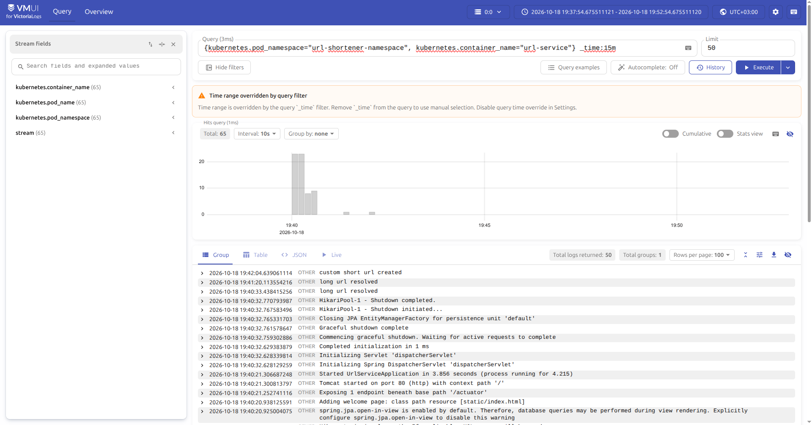
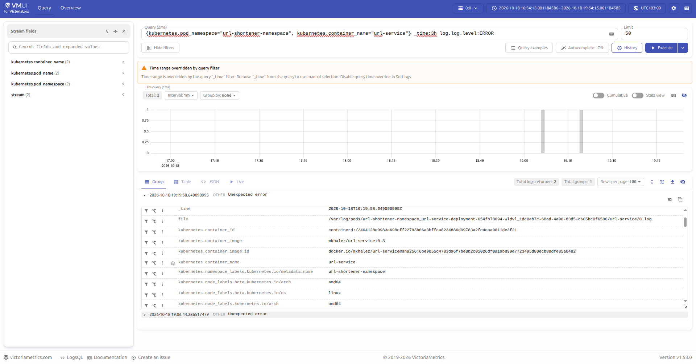
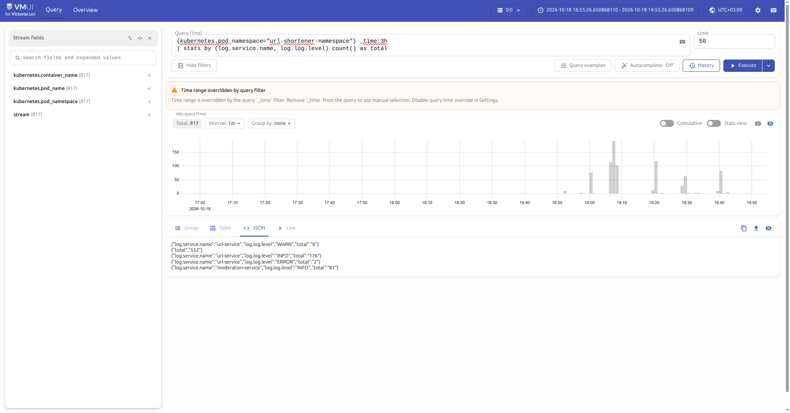
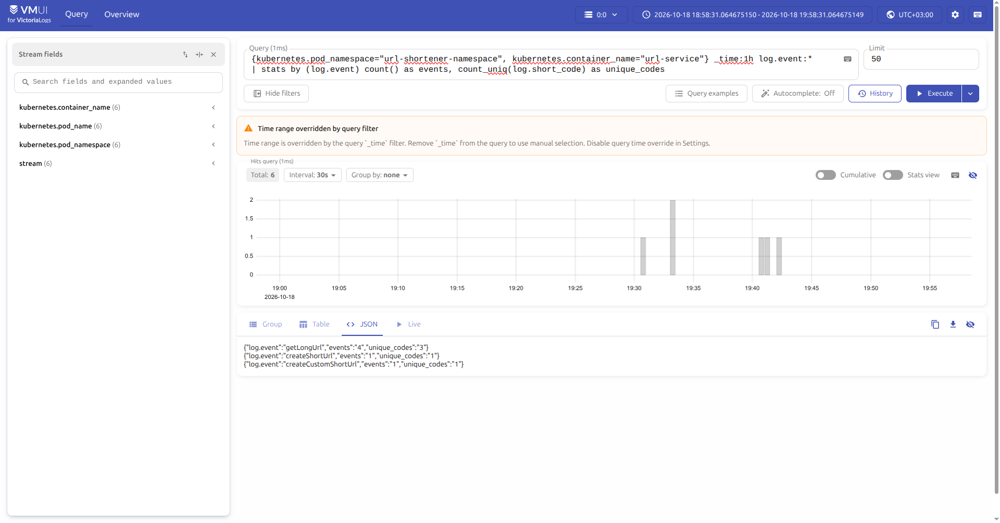

# ДЗ №3. Сбор логов приложения в Victoria Logs

Отчёт о развёртывании single-node Victoria Logs в том же minikube-кластере, где работает
приложение из ДЗ №1 (url-shortener), переводе логов приложения в JSON и настройке доставки
логов в Victoria Logs, а также о 4 выполненных LogsQL-запросах в vmui.

## 1. Что сделано 

| Пункт задания | Решение |
|---|---|
| Развернуть Victoria Logs (single-node) | Helm-chart `victoria-logs-single`, values — `k8s/logging/victoria-logs-values.yaml` |
| Логи приложения в JSON в stdout | Spring Boot structured logging в формате **ECS**: `logging.structured.format.console: ecs` (оба сервиса) |
| Доставка логов в Victoria Logs | Vector (agent/DaemonSet) из того же чарта: source `kubernetes_logs` + `remap` (парсинг JSON) + sink `elasticsearch` (bulk) в Victoria Logs |
| 4 LogsQL-запроса в vmui | Запросы (а)–(г) ниже со скриншотами |

Схема:

```text
поды url-service / moderation-service
        │ stdout (JSON, формат ECS)
        ▼
/var/log/pods/**/*.log  (на ноде)
        │
        ▼
Vector DaemonSet (source kubernetes_logs)
        │  remap:  .log = parse_json(.message) 
        │  + auto-enrichment: kubernetes.pod_name / namespace / container_name
        ▼
Victoria Logs :9428  (ingest через Elasticsearch bulk API, gzip)
        │
        ▼
vmui  (http://localhost:9428/vmui/ через kubectl port-forward)
```

## 2. Развёртывание Victoria Logs

Использован официальный Helm-чарт `victoria-logs-single` (single-node VictoriaLogs,
в footer vmui видно версию сервера `v1.53.0`). Значения — файл
`k8s/logging/victoria-logs-values.yaml`:

```yaml
server:
  retentionPeriod: 2d          
  persistentVolume:
    size: 1Gi            

vector:
  enabled: true            
```

Команды установки (release/namespace подставьте под свой кластер):

```bash
helm repo add vm https://victoriametrics.github.io/helm-charts
helm repo update
helm install victoria-logs vm/victoria-logs-single \
  --namespace logging --create-namespace \
  -f k8s/logging/victoria-logs-values.yaml
```

Проверка и доступ к веб-UI:

```bash
kubectl -n logging get pods,svc,statefulset      
kubectl -n logging port-forward svc/victoria-logs-victoria-logs-single-server 9428:9428
# открыть http://localhost:9428/vmui/
```

Файл `k8s/logging/default-values.yaml` — сохранённый референс всех параметров чарта, чтобы видеть, какой именно конфиг доставки применён.

## 3. JSON-логирование приложения

Оба сервиса переведены на structured logging в формате **ECS** (вместо текстовых логов).
`url-service/src/main/resources/application.yaml`:

```yaml
logging:
  structured:
    format:
      console: ecs
    ecs:
      service:
        name: url-service
        environment: dev
```

`moderation-service/src/main/resources/application.yaml` — аналогично, с
`service.name: moderation-service`.

Дополнительно в код добавлены осмысленные key-value поля через fluent-API SLF4J 2
(`log.atInfo().addKeyValue(...).log("...")`), например в `UrlServiceImpl`:
`event`, `long_url`, `short_code`, `entity_id`, `id`; в `ShortCodeCheckerImpl`:
`shortCode`, `is allowed`.

В результате в stdout каждого пода появляется JSON со стандартными полями чек-листа:
`@timestamp`, `log.level`, `message`, `service.name` (`service.environment`), плюс `ecs.version`
и бизнес-поля. Vector на своей стороне оборачивает распарсенный JSON в объект `.log`, поэтому
в Victoria Logs поля видны как `log.log.level`, `log.service.name`, `log.event`,
`log.short_code`, `log.long_url`, а метаданные Kubernetes — как `kubernetes.pod_namespace`,
`kubernetes.pod_name`, `kubernetes.container_name`.

## 4. Доставка логов в Victoria Logs

Выбран **Vector в роли agent (DaemonSet)**, который поднимается тем же Helm-релизом
(`vector.enabled: true`). Конфигурация Vector (из `default-values.yaml` чарта):

- **source** `kubernetes_logs` — автоматически тейлит `/var/log/pods/**` и обогащает записи
  полями Kubernetes (`kubernetes.pod_name`, `kubernetes.pod_namespace`,
  `kubernetes.container_name`, `file`, `kubernetes.container_image` и т.д.);
- **transform** `parser` (remap):

  ```text
  .log = parse_json(.message) ?? .message
  del(.message)
  ```

  то есть JSON из приложения разбирается на поля, а не остаётся одной строкой;

## 5. LogsQL-запросы в vmui

Доступ к vmui — через port-forward (см. п.2), адрес `http://localhost:9428/vmui/`.

### (а) Сырые записи за последние N минут

Запрос:

```logs
{kubernetes.pod_namespace="url-shortener-namespace", kubernetes.container_name="url-service"} _time:15m
```



Показывает «как есть» поток логов конкретного пода/контейнера за последние 15 минут
(фильтр по stream-полям + `_time:15m`). В выдаче видно сообщения
`custom short url created`, `long url resolved` и стандартные сообщения старта/остановки
Spring Boot. Limit = 50, получено 50 записей. Это базовый запрос для «живого» просмотра
логов и проверки, что доставка вообще работает.

### (б) Фильтр по конкретному полю

Запрос:

```logs
{kubernetes.pod_namespace="url-shortener-namespace", kubernetes.container_name="url-service"} _time:3h log.log.level:ERROR
```



Показывает только записи уровня `ERROR` (фильтр по полю `log.log.level`) за 3 часа.
Найдено 2 записи `Unexpected error` — это реальные ошибки приложения. В развёрнутой записи
видно обогащение: `file=/var/log/pods/...`, `kubernetes.container_image=mkhalez/url-service:0.3`,
`kubernetes.pod_namespace=url-shortener-namespace` и др. Запрос нужен для быстрого поиска
проблем без просмотра всего потока.

### (в) stats-запрос с группировкой

Запрос:

```logs
{kubernetes.pod_namespace="url-shortener-namespace"} _time:3h | stats by (log.service.name, log.log.level) count() as total
```



Считает количество записей с группировкой по сервису (`log.service.name`) и уровню
(`log.log.level`). Результат (`Total: 817`):

```json
{"log.service.name":"url-service","log.log.level":"WARN","total":"6"}
{"log.service.name":"url-service","log.log.level":"INFO","total":"176"}
{"log.service.name":"url-service","log.log.level":"ERROR","total":"2"}
{"log.service.name":"moderation-service","log.log.level":"INFO","total":"81"}
{"total":"552"}
```

Показывает распределение логов по сервисам и уровням (запись без группировочных полей —
`total: 552` — это «сырые» записи без распознанных ECS-полей, напр. не-JSON строки).
Полезно для общей картины «сколько чего пишет каждый сервис».

### (г) Агрегирующий запрос (top / count_uniq)

Запрос:

```logs
{kubernetes.pod_namespace="url-shortener-namespace", kubernetes.container_name="url-service"} _time:1h log.event:* | stats by (log.event) count() as events, count_uniq(log.short_code) as unique_codes
```



Группирует бизнес-события приложения по полю `log.event` и одновременно считает
число событий и число уникальных коротких кодов (`count_uniq(log.short_code)`). Результат:

```json
{"log.event":"getLongUrl","events":"4","unique_codes":"3"}
{"log.event":"createShortUrl","events":"1","unique_codes":"1"}
{"log.event":"createCustomShortUrl","events":"1","unique_codes":"1"}
```

Показывает, какие операции выполнялись (`getLongUrl`, `createShortUrl`,
`createCustomShortUrl`) и сколько уникальных коротких кодов было задействовано —
пример аналитического запроса поверх структурированных логов.

## 6. Артефакты

- `k8s/logging/victoria-logs-values.yaml` — values для установки чарта Victoria Logs.
- `k8s/logging/default-values.yaml` — справочные values чарта (включая конфиг Vector).
- `url-service/src/main/resources/application.yaml`,
  `moderation-service/src/main/resources/application.yaml` — JSON (ECS) логирование.
- `url-service/.../UrlServiceImpl.java`, `moderation-service/.../ShortCodeCheckerImpl.java` —
  структурированные key-value поля и сообщения в логах.
- Скриншоты запросов: `reports/img.png`, `reports/img_1.png`, `reports/img_2.png`,
  `reports/img_3.png`.
