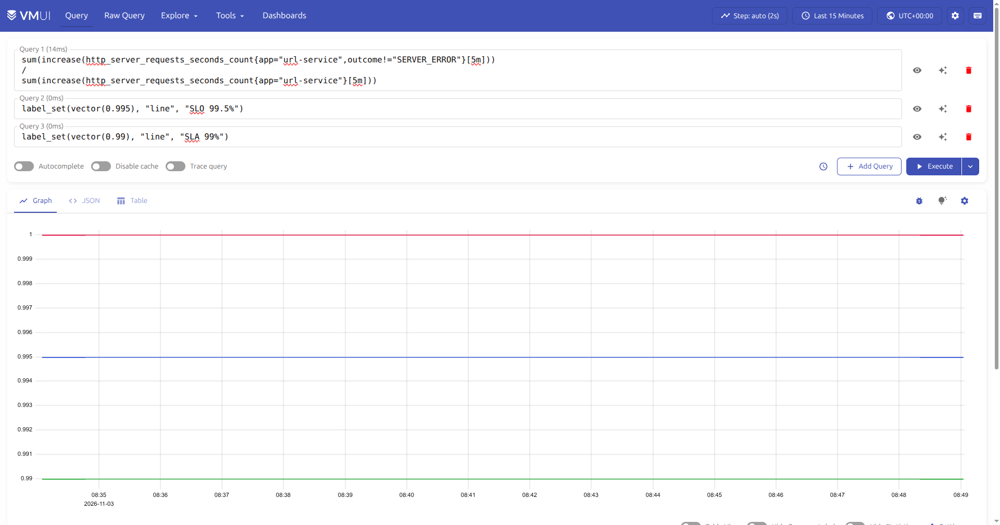
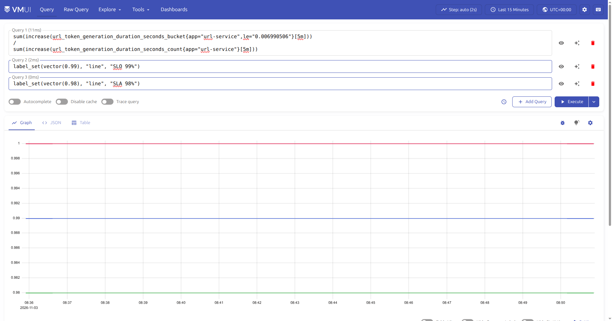
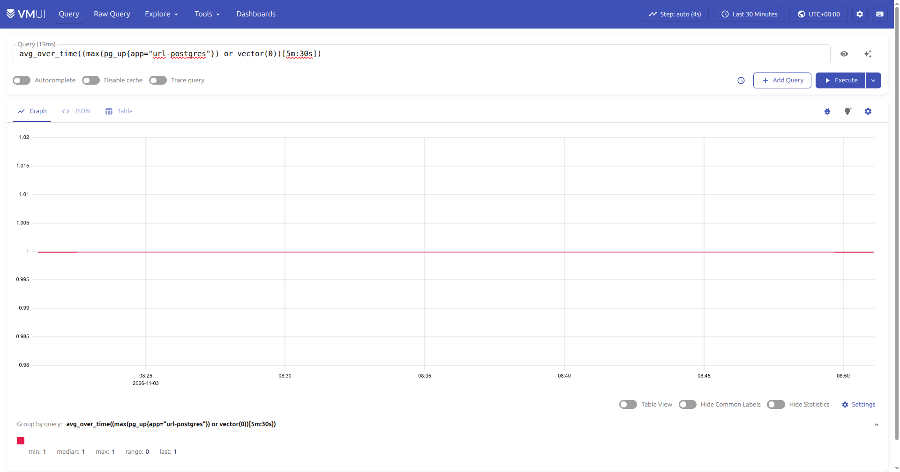
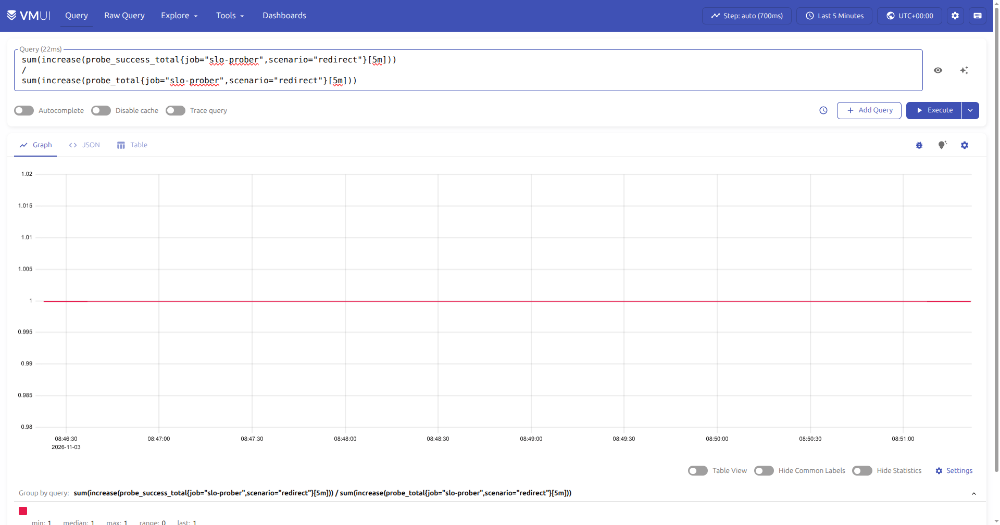

# SLI, SLO и SLA для url-shortener


Использованы оба подхода:

- **RBSLO (Request Based SLO)** — доля успешных запросов: HTTP availability, latency, probe success;
- **TBSLO (Time Based SLO)** — доля времени доступности: PostgreSQL availability.

## SLI №1. Доступность HTTP

### Метрика

`http_server_requests_seconds_count{app="url-service", outcome!="SERVER_ERROR"}`

Micrometer размечает HTTP-запросы лейблом `outcome`. Значение `SERVER_ERROR` соответствует ответам 5xx. Ошибки 4xx считаются ошибками клиента и не уменьшают доступность сервиса.

### Формула

```promql
sum(increase(http_server_requests_seconds_count{
  app="url-service",
  outcome!="SERVER_ERROR"
}[5m]))
/
sum(increase(http_server_requests_seconds_count{
  app="url-service"
}[5m]))
```

### SLO и SLA

| Параметр | Значение |
|---|---|
| SLO | 99.5% успешных запросов за 30 дней |
| SLA | 99.0% успешных запросов за календарный месяц |
| Error budget SLO | 0.5% запросов |

Если за месяц 1 000 000 запросов, допустимо 5 000 ответов 5xx.

### График



Красная линия — фактический SLI. Синяя — SLO 99.5%, зелёная — SLA 99%.

## SLI №2. Задержка генерации токена

### Метрика

`url_token_generation_duration_seconds_bucket{app="url-service", le="0.006990506"}`

Бакет гистограммы, в который входят все генерации токена длительностью не более 6.990506 мс.

### Формула

```promql
sum(increase(url_token_generation_duration_seconds_bucket{
  app="url-service",
  le="0.006990506"
}[5m]))
/
sum(increase(url_token_generation_duration_seconds_count{
  app="url-service"
}[5m]))
```

### SLO и SLA

| Параметр | Значение |
|---|---|
| SLO | 99% генераций токена ≤ 7 мс за 30 дней |
| SLA | 98% генераций токена ≤ 7 мс за календарный месяц |
| Error budget SLO | 1% медленных генераций |

### График



Красная линия — доля генераций ≤ 7 мс. Синяя — SLO 99%, зелёная — SLA 98%.

## SLI №3. Доступность PostgreSQL

### Метрика

`pg_up{app="url-postgres"}`

`pg_up = 1` означает, что `postgres-exporter` успешно подключился к БД.

### Формула

```promql
avg_over_time(
  (max(pg_up{app="url-postgres"}) or vector(0))[5m:30s]
)
```

- `max` сворачивает возможные дубли серий в одну;
- `or vector(0)` превращает отсутствие метрики в `0`, то есть пропавший exporter считается недоступностью;
- `avg_over_time` считает долю времени, когда БД была доступна.

### SLO и SLA

| Параметр | Значение |
|---|---|
| SLO | 99.9% времени доступности за 30 дней |
| SLA | 99.5% времени доступности за календарный месяц |
| Error budget SLO | 43 минуты 12 секунд на 30 дней |
| Error budget SLA | 3 часа 36 минут на 30 дней |

### График



## SLI №4. End-to-end проверка редиректа

### Метрика

Пробер каждые 30 секунд выполняет сценарий:

1. создаёт случайную короткую ссылку через `POST /urls`;
2. переходит по короткому коду через `GET /{code}`;
3. проверяет ответ `302` и заголовок `Location`;
4. удаляет созданную ссылку через `DELETE /urls/{id}`.

Результат публикуется в VictoriaMetrics:

- `probe_success` — gauge `0/1` за последний запуск;
- `probe_total` — счётчик всех проб;
- `probe_success_total` — счётчик успешных проб;
- `probe_duration_seconds` — длительность пробы;
- `probe_http_status_code` — HTTP-код последней пробы;
- `probe_last_run_timestamp_seconds` — время последнего запуска.

### Формула

```promql
sum(increase(probe_success_total{
  job="slo-prober",
  scenario="redirect"
}[5m]))
/
sum(increase(probe_total{
  job="slo-prober",
  scenario="redirect"
}[5m]))
```

### SLO и SLA

| Параметр | Значение |
|---|---|
| SLO | 99% успешных проб за 30 дней |
| SLA | 98% успешных проб за календарный месяц |
| Error budget SLO | 1% проб |

### График



Красная линия — доля успешных проб. На скриншоте `min: 1`, `median: 1`, `max: 1`.

## Реализация пробера

Файлы:

- `k8s/slo/00-prober-configmap.yaml` — Python-скрипт и конфигурация;
- `k8s/slo/10-prober-deployment.yaml` — Deployment `slo-prober`;
- `k8s/slo/20-prober-networkpolicy.yaml` — NetworkPolicy;
- `k8s/networkpolicies/10-url-service-network-policy.yaml` — разрешает ingress от `slo-prober` на порт 80;
- `k8s/networkpolicies/50-vmsingle-network-policy.yaml` — разрешает `slo-prober` отправлять метрики в VictoriaMetrics на порт 8428.

Пробер работает по push-модели: он периодически отправляет метрики на:

```text
http://vmsingle-victoria-metrics-single-server:8428/api/v1/import/prometheus
```

Параметры:

| Параметр | Значение |
|---|---|
| Интервал | 30 секунд |
| Таймаут | 5 секунд |
| Целевой сервис | `url-service:80` |
| Сценарий | `redirect` |

## Изменения приложения для скринкаста

К отчёту приложен скринкаст `reports/service_down.webm`: в нём демонстрируется падение сервиса и изменение метрик — после отключения `moderation-service` запросы на создание кастомных ссылок возвращают `503`, HTTP SLI снижается.

Для демонстрации деградации используется управляемое изменение поведения приложения:

```bash
kubectl -n url-shortener-namespace port-forward \
  svc/vmsingle-victoria-metrics-single-server 8428:8428
```

```text
http://localhost:8428/vmui/
```

```bash
# Уронить url-service
kubectl -n url-shortener-namespace scale \
  deploy/url-service-deployment --replicas=0

# Подождать 1–2 минуты и обновить графики
# Поднять сервис обратно
kubectl -n url-shortener-namespace scale \
  deploy/url-service-deployment --replicas=2
```