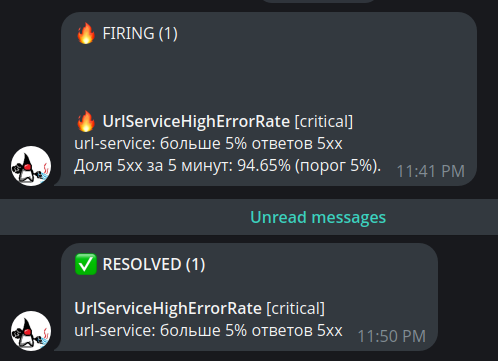

# Алертинг url-shortener

### Конфигурация алертов

| Файл | Назначение |
|---|---|
| `k8s/alerting/alerts-configmap.yaml` | ConfigMap `vmalert-rules` с четырьмя правилами |
| `k8s/alerting/vmalert-configmap.yaml` | ConfigMap `vmalert-config` с флагами vmalert |
| `k8s/alerting/vmalert-deployment.yaml` | Deployment vmalert с requests/limits |
| `k8s/alerting/vmalert-service.yaml` | Service для UI и API vmalert |
| `k8s/alerting/alertmanager-values.yaml` | Helm-values Alertmanager: маршруты, Telegram, шаблон |
| `k8s/alerting/alertmanager-telegram-secret.example.yaml` | Пример Secret с fake-токеном |

### Сетевые политики

- `k8s/networkpolicies/50-vmsingle-network-policy.yaml` — ingress от vmalert к VictoriaMetrics на `8428`;
- `k8s/networkpolicies/60-alertmanager-network-policy.yaml` — ingress от vmalert к Alertmanager на `9093`;
- `k8s/networkpolicies/70-vmalert-network-policy.yaml` — egress vmalert к DNS, VictoriaMetrics и Alertmanager.

## Алерты

| № | Алерт | Тип | Метрика | Условие | `for` | Severity |
|---|---|---|---|---|---|---|
| 1 | `UrlServiceHighErrorRate` | сервис | `http_server_requests_seconds_count` | доля 5xx > 5% при трафике > 0.2 rps | 2m | critical |
| 2 | `UrlTokenGenerationSlow` | сервис | `url_token_generation_duration_seconds_bucket` | p95 генерации токена > 1s | 2m | warning |
| 3 | `JvmHeapUsageHigh` | runtime | `jvm_memory_used_bytes` / `jvm_memory_max_bytes` | heap > 85% | 5m | warning |
| 4 | `HikariConnectionPoolSaturation` | framework | `hikaricp_connections_pending` | есть запросы в очереди пула | 2m | critical |

### `UrlServiceHighErrorRate`

```promql
(
  sum(rate(http_server_requests_seconds_count{
    app="url-service",
    outcome="SERVER_ERROR",
    uri!~"/actuator.*"
  }[5m]))
  /
  sum(rate(http_server_requests_seconds_count{
    app="url-service",
    uri!~"/actuator.*"
  }[5m]))
) > 0.05
and
sum(rate(http_server_requests_seconds_count{
  app="url-service",
  uri!~"/actuator.*"
}[5m])) > 0.2
```

- `outcome="SERVER_ERROR"` — это 5xx. Ошибки 4xx являются ошибками клиента и не должны снижать доступность сервиса.
- `uri!~"/actuator.*"` — исключает health-пробы Kubernetes.
- `for: 2m` отсекает единичные всплески.
- Условие `sum(rate(...)) > 0.2` защищает от ложных срабатываний при почти нулевом трафике.
.

### `UrlTokenGenerationSlow`

```promql
histogram_quantile(
  0.95,
  sum by (le) (
    rate(url_token_generation_duration_seconds_bucket{app="url-service"}[5m])
  )
) > 1
and
sum(rate(url_token_generation_duration_seconds_count{app="url-service"}[5m])) > 0.2
```

- Используется p95, а не `max`: одиночный медленный вызов не должен поднимать тревогу.
- Порог 1 секунда: генерация короткого токена в норме занимает миллисекунды, секунда — явная деградация.
- `for: 2m` и проверка трафика не дают алерту срабатывать на пустом сервисе.

### `JvmHeapUsageHigh`

```promql
(
  sum by (app, pod) (jvm_memory_used_bytes{app="url-service", area="heap"})
  /
  sum by (app, pod) (jvm_memory_max_bytes{app="url-service", area="heap"} > 0)
) > 0.85
```


- Сравнивается использованный heap с максимальным.
- Порог 85% оставляет запас до `OutOfMemoryError`.
- Алерт считается отдельно по каждому поду, чтобы было видно, какой экземпляр деградировал.

### `HikariConnectionPoolSaturation`

```promql
sum by (app, pod) (
  hikaricp_connections_pending{app="url-service"}
) > 0
```

- `hikaricp_connections_pending` - число запросов, ожидающих соединение из пула.
- `for: 2m` исключает кратковременные всплески.
- Разбивка `by (app, pod)` позволяет понять, на каком поде закончились соединения.

## Alertmanager

### 5.1. Маршрутизация

```yaml
route:
  receiver: telegram
  group_by: [alertname, service]
  group_wait: 10s
  group_interval: 1m
  repeat_interval: 2h
  routes:
    - matchers: [severity="critical"]
      receiver: telegram
      repeat_interval: 30m
    - matchers: [severity="warning"]
      receiver: telegram
      repeat_interval: 4h
```

- `group_by: [alertname, service]` объединяет однотипные алерты, но не смешивает разные алерты в одну группу.
- `group_wait: 10s` — небольшое ожидание, чтобы успеть собрать связанные алерты.
- `group_interval: 1m` — как часто отправлять обновления по уже активной группе.
- `repeat_interval` для critical — 30 минут, для warning — 4 часа: критичные проблемы напоминают о себе чаще.

### Telegram

```yaml
receivers:
  - name: telegram
    telegram_configs:
      - bot_token_file: /etc/alertmanager/secrets/telegram-token
        chat_id: <chat_id>
        parse_mode: HTML
        send_resolved: true
```

Токен лежит в Secret `alertmanager-telegram` и монтируется в pod через `extraSecretMounts` в файл `/etc/alertmanager/secrets/telegram-token`.

`send_resolved: true` включает уведомления о восстановлении.

### 5.3. Подавление

```yaml
inhibit_rules:
  - source_matchers: [alertname="HikariConnectionPoolSaturation"]
    target_matchers: [alertname="UrlTokenGenerationSlow"]
    equal: [service]
```

Если пул соединений исчерпан, медленная генерация токена является следствием. Подавляем вторичный алерт, чтобы не получать два уведомления об одной причине.

### 5.4. Шаблон сообщения

Используются отдельные блоки для firing и resolved:

```gotemplate
{{- if .Alerts.Firing }}🔥 <b>FIRING ({{ len .Alerts.Firing }})</b>
{{ range .Alerts.Firing }}
...
{{ end }}
{{- end }}
{{- if .Alerts.Resolved }}✅ <b>RESOLVED ({{ len .Alerts.Resolved }})</b>
{{ range .Alerts.Resolved }}
...
{{ end }}
{{- end }}
```

Это важно для смешанных групп. `.Status` описывает группу целиком: если в группе есть и горящий, и восстановившийся алерт, группа всё равно считается `firing`. При использовании одного `{{ range .Alerts }}` resolved-алерты оказались бы под заголовком `FIRING`. Отдельные `.Alerts.Firing` и `.Alerts.Resolved` решают эту проблему.

Дополнительно в шаблон выводится `pod`, если он есть в labels, чтобы различать алерты Hikari на разных подах.

## vmalert

Флаги вынесены в ConfigMap `vmalert-config`:

```yaml
VMALERT_RULE: "/etc/vmalert/alerts.yaml"
VMALERT_DATASOURCE_URL: "http://vmsingle-victoria-metrics-single-server:8428"
VMALERT_NOTIFIER_URL: "http://alertmanager:9093"
VMALERT_REMOTE_WRITE_URL: "http://vmsingle-victoria-metrics-single-server:8428"
VMALERT_REMOTE_READ_URL: "http://vmsingle-victoria-metrics-single-server:8428"
VMALERT_EVALUATION_INTERVAL: "30s"
VMALERT_HTTP_LISTEN_ADDR: ":8080"
```

В Deployment они передаются через `envFrom` и подставляются в `args`:

```yaml
args:
  - -rule=$(VMALERT_RULE)
  - -datasource.url=$(VMALERT_DATASOURCE_URL)
  - -notifier.url=$(VMALERT_NOTIFIER_URL)
  - -remoteWrite.url=$(VMALERT_REMOTE_WRITE_URL)
  - -remoteRead.url=$(VMALERT_REMOTE_READ_URL)
  - -evaluationInterval=$(VMALERT_EVALUATION_INTERVAL)
  - -httpListenAddr=$(VMALERT_HTTP_LISTEN_ADDR)
```

### Персистентность состояния

По умолчанию vmalert хранит состояние алертов в памяти, и после рестарта все алерты начинают с `inactive`. Добавлены:

- `-remoteWrite.url` — vmalert сохраняет состояние в VictoriaMetrics;
- `-remoteRead.url` — восстанавливает состояние при старте.

Оба указывают на `http://vmsingle-victoria-metrics-single-server:8428`.


## Демонстрация

### Сценарий с `UrlServiceHighErrorRate`

`moderation-service` был масштабирован до нуля:

```bash
kubectl -n url-shortener-namespace scale \
  deploy/moderation-service-deployment --replicas=0
```

После этого `url-service` при создании кастомной ссылки не мог вызвать moderation и возвращал `503 Service Unavailable`.

Для устойчивого трафика использовался цикл на 10 запросов в секунду в течение 6 минут.

Основная масса ответов — `503`. В Alertmanager появился активный алерт, в Telegram пришло уведомление:

Скриншот: `reports/alert.png`.

