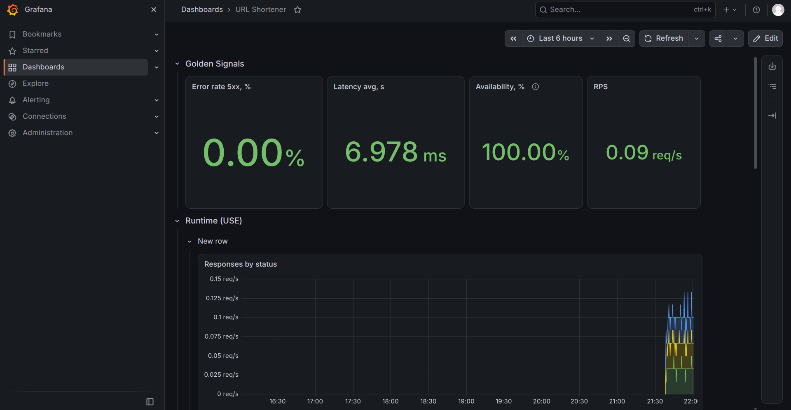
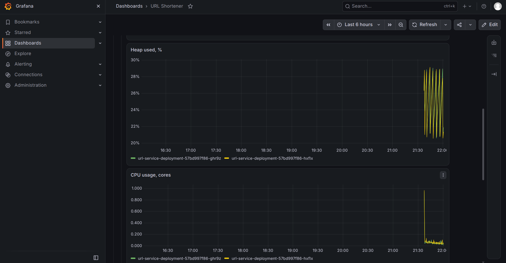
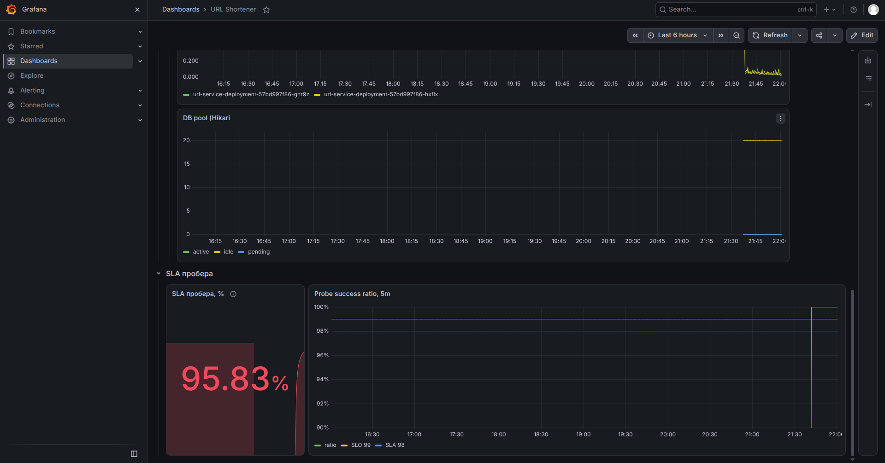
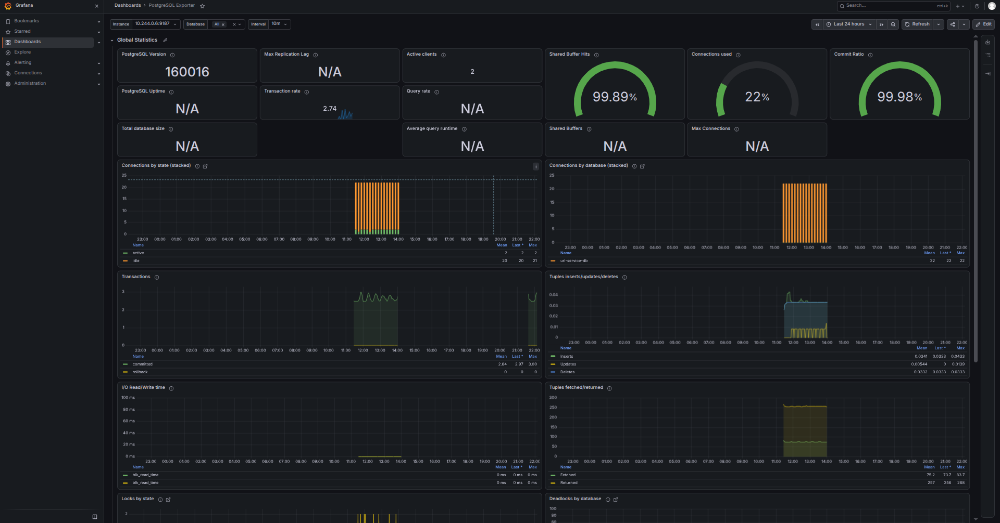

# Дашборд Grafana для url-shortener

Дашборд «URL Shortener» состоит из четырёх рядов: Golden Signals, Runtime (USE),
SLA пробера и PostgreSQL.

### Ряд 1. Golden Signals



**Availability, %**

```promql
100 * sum(rate(http_server_requests_seconds_count{
  app="url-service",
  uri!~"/actuator.*",
  outcome=~"SUCCESS|REDIRECTION|INFORMATIONAL"
}[$__rate_interval]))
/
clamp_min(
  sum(rate(http_server_requests_seconds_count{
    app="url-service",
    uri!~"/actuator.*",
    outcome!~"CLIENT_ERROR|UNKNOWN"
  }[$__rate_interval])),
  0.001
)
```

Golden Signal «Errors/Success»,`clamp_min` с порогом `0.001`
защищает от деления на ноль при полном отсутствии трафика.

**RPS**

```promql
sum(rate(http_server_requests_seconds_count{
  app="url-service",
  uri!~"/actuator.*"
}[$__rate_interval]))
```

Golden Signal «Traffic». На скриншоте ~0.09 req/s — это трафик, который генерирует
сам SLA-пробер (создание ссылки, редирект, удаление каждые 30 секунд).

**Error rate 5xx, %**

```promql
100 * (
  sum(rate(http_server_requests_seconds_count{
    app="url-service",
    outcome="SERVER_ERROR",
    uri!~"/actuator.*"
  }[$__rate_interval]))
  or vector(0)
)
/
clamp_min(
  sum(rate(http_server_requests_seconds_count{
    app="url-service",
    uri!~"/actuator.*"
  }[$__rate_interval])),
  0.001
)
```

Golden Signal «Errors». `or vector(0)` подставляет ноль, когда 5xx ещё ни разу не было.

**Latency avg, s**

```promql
sum(rate(http_server_requests_seconds_sum{
  app="url-service",
  uri!~"/actuator.*"
}[$__rate_interval]))
/
clamp_min(
  sum(rate(http_server_requests_seconds_count{
    app="url-service",
    uri!~"/actuator.*"
  }[$__rate_interval])),
  0.001
)
```

Golden Signal «Latency».

**Responses by status**

```promql
sum by (status) (rate(http_server_requests_seconds_count{
  app="url-service",
  uri!~"/actuator.*"
}[$__rate_interval]))
```

Стековый график по HTTP-кодам показывает, растут ли 4xx/5xx. Легенда — `{{status}}`.

### Ряд 2. Runtime (USE)



**CPU usage, cores**

```promql
sum by (pod) (process_cpu_usage{app="url-service"})
```

**Heap used, %**

```promql
100 * sum by (pod) (jvm_memory_used_bytes{app="url-service",area="heap"})
/
clamp_min(
  sum by (pod) (jvm_memory_max_bytes{app="url-service",area="heap"}),
  1
)
```

**Utilization** памяти: отношение занятого heap к максимальному.

**DB pool (Hikari)** — три запроса на одной панели:

```promql
sum(hikaricp_connections_active{app="url-service"})
```

```promql
sum(hikaricp_connections_idle{app="url-service"})
```

```promql
sum(hikaricp_connections_pending{app="url-service"})
```

Панель отражает состояние пула соединений HikariCP между приложением и PostgreSQL и относится к saturation.

- active — число соединений, которые прямо сейчас заняты выполнением запросов к базе. Рост этого значения означает, что приложение активнее использует БД, а упор в максимальный размер пула говорит о том, что ресурс исчерпан.
- idle — число свободных соединений, которые открыты и ждут нового запроса. Это запас пула: если он стабильно равен нулю, при очередном всплеске нагрузки свободных соединений не окажется.
- pending — число потоков приложения, которые стоят в очереди и ждут освобождения соединения. В норме значение равно нулю, а его рост первым сигнализирует о деградации БД или нехватке размера пула, так как запросы начинают задерживаться ещё до появления ошибок.



### Ряд 3. SLA пробера

Отдельный ряд, как требует задание.

**SLA пробера, %**

```promql
100 * avg_over_time(probe_success{
  job="slo-prober",
  scenario="redirect"
}[$__range])
```

Доля успешных проб за выбранный период

**Probe success ratio, 5m** — три запроса на одной панели:

```promql
100 * sum(increase(probe_success_total{
  job="slo-prober",
  scenario="redirect"
}[5m]))
/
clamp_min(
  sum(increase(probe_total{
    job="slo-prober",
    scenario="redirect"
  }[5m])),
  1
)
```

```promql
vector(99)
```

```promql
vector(98)
```

Первая серия это доля успешных проб за последние 5 минут. Две другие серии константы: они рисуют на том же графике линии цели SLO (99%) и обязательства SLA (98%), чтобы сразу было видно, когда доля опускается ниже них.

### Ряд 4. PostgreSQL

Импортированный community-дашборд **PostgreSQL Exporter** с grafana.com,
datasource — VictoriaMetrics. Экспортированный JSON приложен к отчёту.



В переменной `Instance` выбран инстанс экспортёра (`10.244.0.6:9187`), `Database` — `All`, `Interval` — `10m`.

## Дашборды

| Дашборд | Файл |
|---|---|
| JSON дашборда приложения | `reports/URL Shortener-1794998032414.json` |
| JSON импортированного дашборда PostgreSQL | `reports/PostgreSQL Exporter-1794998670446.json` |
